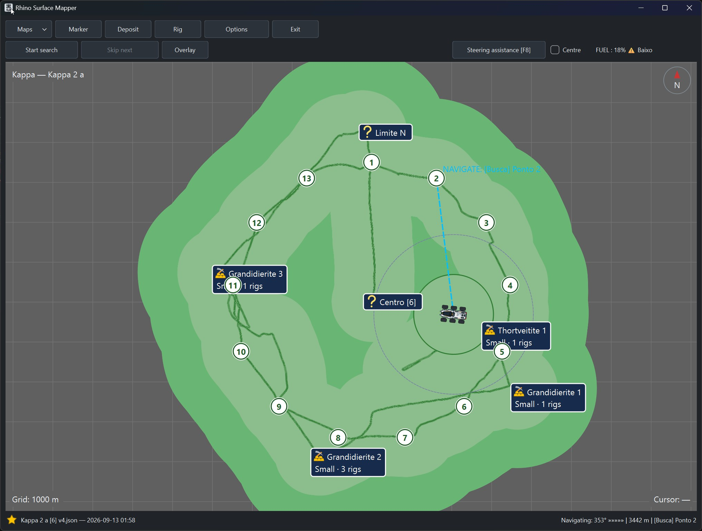
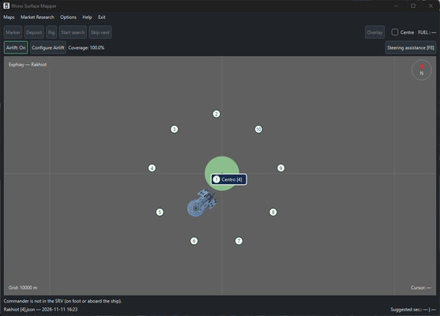
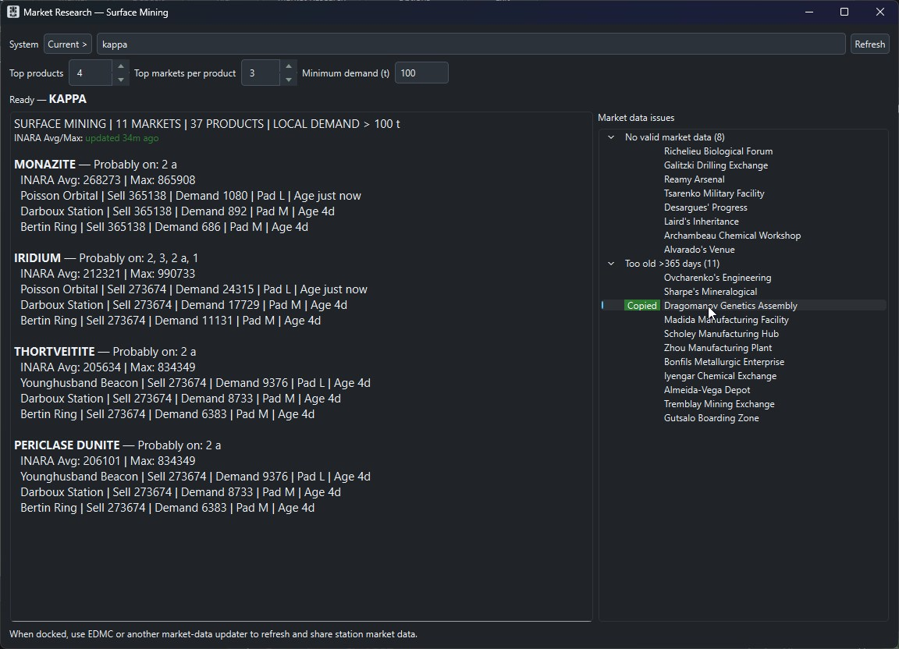
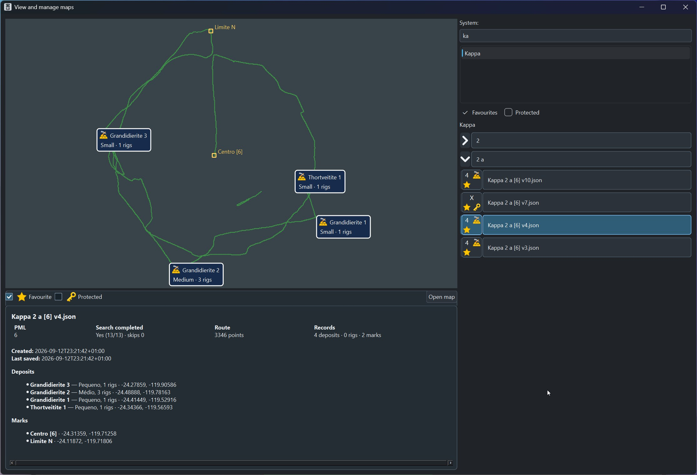
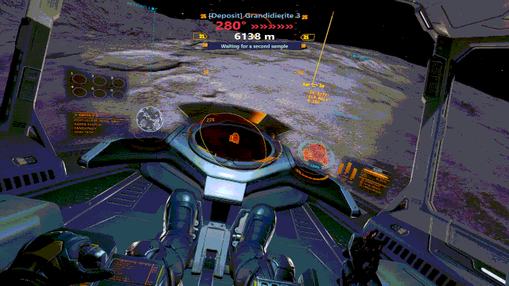

# Rhino Surface Mapper

Rhino Surface Mapper is an independent companion tool for *Elite Dangerous* Commanders, focused on surface exploration, mapping and navigation. It helps you record where you have explored, plan systematic searches, mark points of interest and return to them later.

## Why Rhino Surface Mapper?

When Surface Mining and the Rhino SRV arrived in *Elite Dangerous*, I found it difficult to explore mining sites systematically. I wanted to avoid covering the same ground repeatedly, keep track of the areas I had already searched, and remember where I had found deposits worth returning to. I started Rhino Surface Mapper to solve that problem for myself. It gradually grew into a companion tool that I hope other Commanders will also find useful.

## Download and installation

Beta 3 is available from [GitHub Releases](https://github.com/pbgaspar/rhino-surface-mapper/releases). It requires 64-bit Windows 10 or Windows 11. Features that use live game telemetry require *Elite Dangerous*.

Rhino Surface Mapper is distributed as a portable ZIP:

1. Download the Beta 3 ZIP from the releases page.
2. Extract the entire ZIP to a writable folder. Do not run the application from inside the ZIP.
3. Keep the extracted files and subfolders together. Avoid protected locations such as `Program Files`.
4. Run `RhinoSurfaceMapper.exe`.

The application stores its settings in `options.json` and maps in `MAPAS/` beside the executable.

### Upgrading to Beta 3

Install Beta 3 into a new folder rather than extracting it over an earlier installation. With Rhino Surface Mapper closed, copy these items from the previous installation:

- `MAPAS/` — saved maps;
- `MAPAS_TRASH/` — maps in Trash, if this folder is present;
- `options.json` — settings and preferences.

Keep the previous installation until you have verified that the maps and settings are present and Beta 3 is working as expected. Market Research cache files do not need to be transferred; the application can refresh its cache.

## Main features

### Surface mapping and exploration

- View the SRV position, heading and fuel telemetry from *Elite Dangerous* `Status.json`. Journal data supplies system identity when needed.
- Record exploration tracks and follow systematic search routes.
- Mark mining deposits, rigs and named points of interest.
- View radar coverage and pulses, and navigate to recorded map points.
- Save maps as JSON and open them again later. Maps can also be opened with **Maps → Open from file…**.

### Ship-assisted exploration

An active PML map can remain visible after you leave the SRV. When the ship's position and heading are valid and correspond to the active map and telemetry context, they can be displayed on the map. You can navigate to recorded locations and Airlift deployment points while exploring from the ship.

## Airlift — PML survey planning

Airlift helps plan multiple Rhino deployment positions for systematically surveying a PML area. Choose a target radius of 5 km or 7 km and an available operational deployment count. Each planned point has a 2 km coverage circle; the application updates the positions and estimated geometric coverage percentage when the configuration changes.

Coverage circles are centered on the planned deployment points, not continuously on the ship. The estimate describes geometric coverage and does not guarantee that every operational configuration reaches exactly 100%.

Airlift points can be used as navigation targets. Airlift is a separate workflow from **Start search**, and its activation lasts for the current session.

Airlift development originated from a suggestion by Commander [@JackInTheMines](https://github.com/JackInTheMines), submitted in [Issue #2 — Support PML survey via ship](https://github.com/pbgaspar/rhino-surface-mapper/issues/2).

The proposal inspired the investigation of different circular coverage arrangements and Rhino deployment-point configurations. The final solution was adapted to the operational requirements of Rhino Surface Mapper and does not necessarily follow the exact geometric arrangement originally suggested.

## Surface Mining Market Research

Market Research finds markets in a system with demand for mineable Surface Mining commodities. It displays prices and market-data age where available, and indicates probable planet types for commodities to help guide prospecting. The feature combines market information from Spansh with INARA reference prices, and caches data to reduce repeated requests. Markets with demand may also present potential Powerplay merit opportunities; results depend on current game and market data.

## Map Library

Browse saved maps, systems and map versions. Mark maps as favorites or protected, move maps to Trash and restore them later. Map records can include deposits, exploration routes, rigs and named markers.

## Navigation overlay and steering assistance

The optional transparent overlay presents navigation information while you play. Optional steering assistance can help follow a target when valid telemetry and configured input conditions are available.

Steering assistance does not detect obstacles or guarantee safe traversal. Observing radar input does not prove that an in-game pulse was successfully fired.

## Configuration and customization

Configure map display, radar, navigation, Airlift, the overlay and steering assistance in Options. Choose the **System**, **Dark** or **Light** theme.

## Languages

Rhino Surface Mapper supports English and Portuguese (Portugal). Select a language in Options and restart the application to apply the change.

## Development and contributing

Rhino Surface Mapper is written in Python and uses PySide6 / Qt. Selected static layouts use Qt Designer `.ui` files. The project separates presentation, domain logic, telemetry and I/O, and uses pytest for automated tests.

See [`CONTRIBUTING.md`](CONTRIBUTING.md) for development and contribution guidance.

## Bug reports and feature requests

Report reproducible bugs or request features through [GitHub Issues](https://github.com/pbgaspar/rhino-surface-mapper/issues). Include steps to reproduce a problem and relevant application or game details where possible.

## Author

**CMDR Paulo Gaspar** created and maintains Rhino Surface Mapper, with development assistance from ChatGPT and AI coding tools.

## Licence and third-party components

Rhino Surface Mapper is licensed under the [GNU GPL-3.0](LICENSE). Runtime component notices are listed in [`THIRD_PARTY_NOTICES.txt`](THIRD_PARTY_NOTICES.txt), with corresponding source information in [`SOURCE_AVAILABILITY.txt`](SOURCE_AVAILABILITY.txt).

Rhino Surface Mapper is an independent project and is not affiliated with or endorsed by Frontier Developments. *Elite Dangerous* and related marks belong to Frontier Developments plc.
